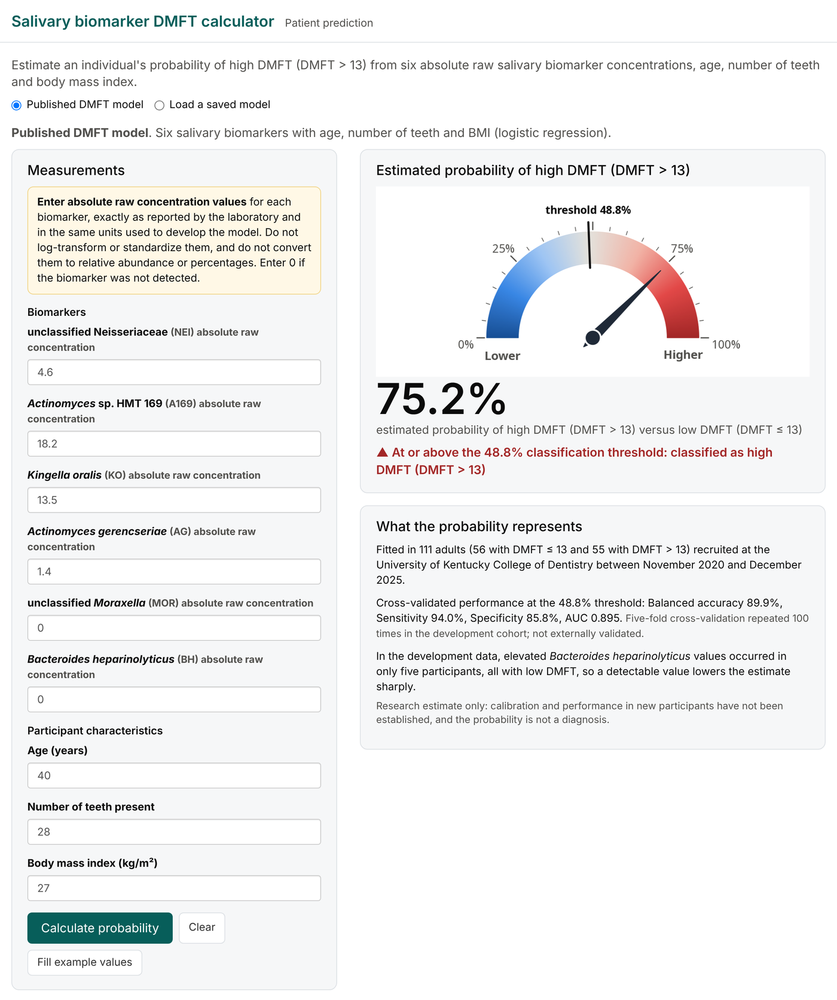

# Salivary biomarker DMFT calculator

Estimate an individual's probability of high DMFT (DMFT > 13) from six salivary biomarkers, age, number of teeth and body mass index.

### [Open the calculator →](https://qiyan14.github.io/dmft-calculator/)

The calculator runs entirely in your web browser: there is nothing to install, and the values you enter are not sent to or stored on any server. The first visit takes about 10–30 seconds while R starts in the browser.



## How to use it

1. Keep **Published DMFT model** selected.
2. Enter the six biomarkers as **absolute raw concentration values**, exactly as reported by the laboratory and in the units used to develop the model. Do not log-transform or standardize them or convert them to relative abundance, and enter 0 if a biomarker was not detected.
3. Enter age (years), number of teeth present and BMI (kg/m²).
4. Click **Calculate probability**.

The page shows the estimated probability on a gauge with the classification at the 48.8% threshold, the model equation with its coefficients, and a term-by-term calculation for the values entered. **Fill example values** enters illustrative values (not a real participant). **Load a saved model** applies a model saved from the desktop version of the calculator.

## The model

A logistic regression fitted in 111 adults (56 with DMFT ≤ 13 and 55 with DMFT > 13) recruited at the University of Kentucky College of Dentistry between November 2020 and December 2025:

```
logit p(HD) = −6.65 − 0.0483 log2(NEI + δ) + 0.0843 log2(A169 + δ) + 0.0609 log2(KO + δ)
                    + 0.0964 log2(AG + δ) + 0.106 log2(MOR + δ) − 0.804 log2(BH + δ)
                    + 0.116 Age − 0.464 Teeth + 0.0372 BMI
```

NEI, A169, KO, AG, MOR and BH are the raw values of unclassified Neisseriaceae, *Actinomyces* sp. HMT 169, *Kingella oralis*, *Actinomyces gerencseriae*, unclassified *Moraxella* and *Bacteroides heparinolyticus*, and δ = 5 × 10⁻⁷. Coefficients are rounded here; the calculator uses the unrounded values.

In five-fold cross-validation repeated 100 times in the development cohort, the model had a balanced accuracy of 89.9%, sensitivity of 94.0%, specificity of 85.8% and AUC of 0.895 at the 48.8% threshold. It has not been externally validated. Elevated *Bacteroides heparinolyticus* values occurred in only five participants, all with low DMFT, so a detectable value lowers the estimate sharply.

## Research use only

Estimates come from a cross-sectional development cohort and have not been externally validated. They are not a diagnosis and do not replace a dental examination.

## Citation

Manuscript in preparation.

## About this repository

`app/app.R` is the calculator, an R Shiny app; `shiny::runApp("app")` runs it locally. `docs/` is the same app built with [Shinylive](https://posit-dev.github.io/r-shinylive/) so that it runs in the browser, and GitHub Pages serves the website from there. [PUBLISHING.md](PUBLISHING.md) explains how to publish and update the site.
